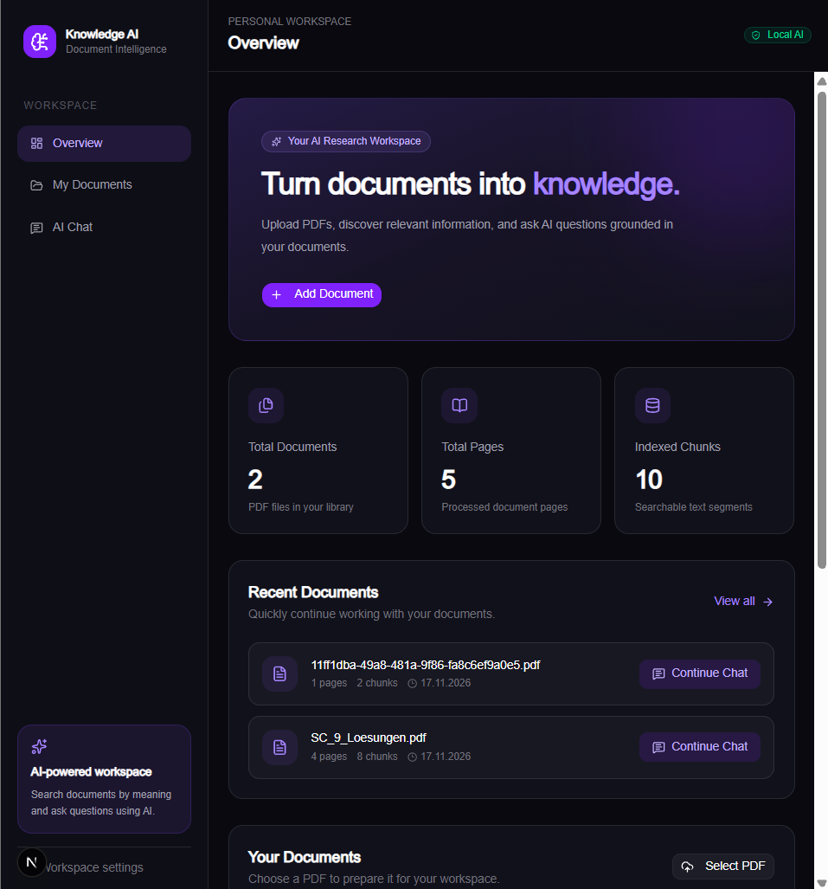
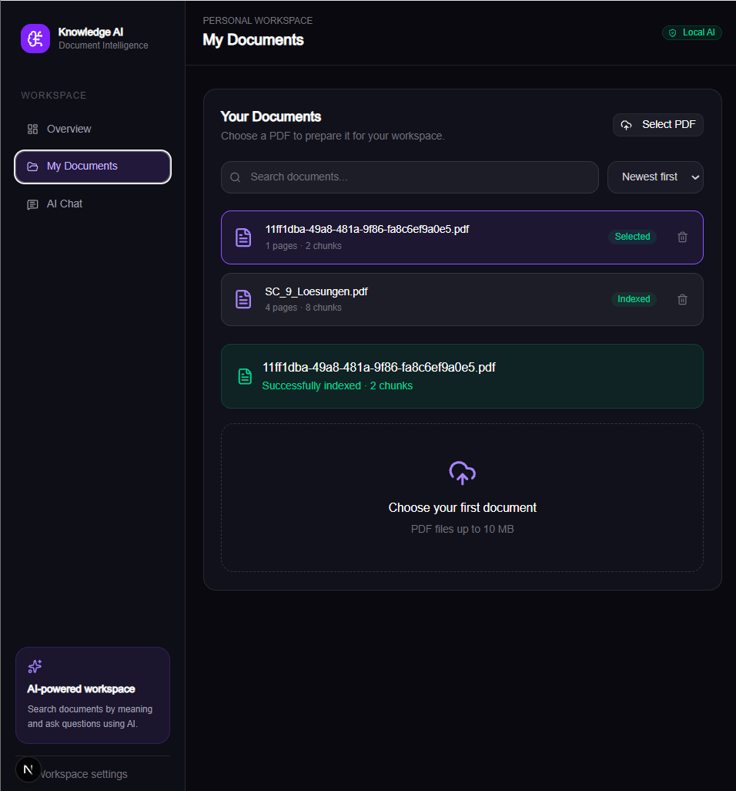
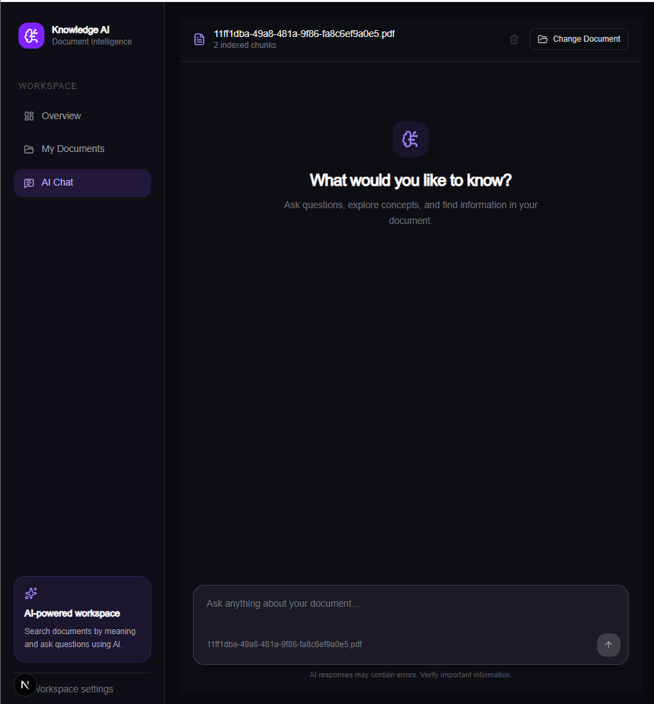

# AI Knowledge Assistant

An AI-powered document intelligence application built with Next.js, FastAPI, PostgreSQL, pgvector, and Ollama.

Upload PDF documents, search their content semantically, and ask questions using a Retrieval-Augmented Generation (RAG) pipeline powered by a local large language model.

**Project status:** Active development — Full-stack MVP implemented.

## Features

### Document Management

- PDF upload with file validation (10 MB limit)
- Automatic text extraction and document indexing
- Persistent document metadata and embeddings
- Document library with search and sorting
- Recent documents and dashboard statistics
- Document deletion with confirmation
- Document-specific AI chat

### AI and RAG

- Multilingual embeddings using `intfloat/multilingual-e5-small`
- Semantic vector search with PostgreSQL and pgvector
- Retrieval of relevant PDF text chunks
- Local LLM integration using Ollama and Qwen2.5
- Optional OpenAI API integration
- AI-generated answers based on retrieved document context
- Retrieved source references with page and chunk information
- Error handling for unavailable and unresponsive LLM services

### Frontend

- Next.js application with TypeScript and Tailwind CSS
- shadcn/ui components and responsive dark interface
- Dedicated AI chat workspace
- Chat history stored locally per document
- Markdown and LaTeX rendering
- Document statistics and recent document shortcuts
- Custom confirmation dialogs and toast notifications
- Searchable, sortable document library

## Tech Stack

| Layer                 | Technologies                                   |
| --------------------- | ---------------------------------------------- |
| Frontend              | Next.js 16, React, TypeScript                  |
| Styling               | Tailwind CSS, shadcn/ui, Lucide                |
| Backend               | Python 3.13, FastAPI, Uvicorn                  |
| PDF Processing        | PyMuPDF                                        |
| Embeddings            | Sentence Transformers, multilingual-e5-small   |
| Vector Database       | PostgreSQL 17, pgvector                        |
| LLM                   | Ollama, Qwen2.5 3B                             |
| Optional LLM Provider | OpenAI API                                     |
| Infrastructure        | Docker Compose for PostgreSQL                  |
| Testing               | pytest, FastAPI TestClient, TypeScript, ESLint |

## Architecture

```text
                  Next.js Frontend
                         |
                         | HTTP API
                         v
                    FastAPI Backend
                         |
             +-----------+-----------+
             |                       |
             v                       v
       PDF Processing           AI Question
             |                       |
             v                       v
       Text Extraction          Query Embedding
             |                       |
             v                       v
       Text Chunking            Vector Search
             |                       |
             v                       |
       Text Embeddings                |
             |                       |
             v                       v
        PostgreSQL + pgvector
                         |
                         v
                 Retrieved Context
                         |
                         v
                  Ollama / Qwen2.5
                         |
                         v
                   AI Response
                         |
                         v
              Answer + Source References
```

### RAG Workflow

1. A user uploads a PDF document.
2. FastAPI validates and stores the uploaded file.
3. PyMuPDF extracts text from the document.
4. The extracted text is divided into overlapping chunks.
5. Each chunk is converted into a 384-dimensional embedding.
6. Document metadata, chunks, and embeddings are saved in PostgreSQL.
7. When a user asks a question, the question is embedded.
8. pgvector retrieves the most relevant document chunks.
9. Ollama generates an answer using the retrieved context.
10. The frontend displays the response and retrieved source references.

Retrieved sources identify relevant document sections. They are not independently verified citations.

## Getting Started

The following instructions describe local development on Windows using PowerShell.

### Prerequisites

- Python 3.13
- Node.js and npm
- Docker Desktop
- Ollama
- Git

### 1. Clone the repository

```powershell
git clone https://github.com/AndriiVDO/ai-knowledge-assistant.git
cd ai-knowledge-assistant
```

### 2. Configure environment variables

Copy the example configuration:

```powershell
Copy-Item .env.example .env
```

Set a PostgreSQL password in `.env`.

Example configuration:

```dotenv
POSTGRES_PASSWORD=change_me
OPENAI_API_KEY=
LLM_PROVIDER=ollama
OLLAMA_MODEL=qwen2.5:3b
OPENAI_MODEL=gpt-4.1-mini
```

Replace `change_me` with a local password.

An OpenAI API key is not required when using Ollama.

Never commit real passwords or API keys.

### 3. Start PostgreSQL

Start Docker Desktop, then run:

```powershell
docker compose up -d
docker ps
```

The database container is named:

`ai-knowledge-postgres`

Local PostgreSQL configuration:

| Setting  | Value             |
| -------- | ----------------- |
| Host     | 127.0.0.1         |
| Port     | 5434              |
| Database | ai_knowledge      |
| User     | ai_user           |
| Password | Value from `.env` |

### Automatic Database Initialization

PostgreSQL is managed using Docker Compose.

On the first startup with an empty PostgreSQL data volume, Docker automatically executes `database/init.sql`.

The initialization script:

- Enables the pgvector extension.
- Creates the `documents` table.
- Creates the `document_chunks` table with 384-dimensional embeddings.
- Configures the foreign key with `ON DELETE CASCADE`.
- Creates the index for document chunk retrieval.

Database data is stored in a persistent Docker volume, so restarting the container does not delete documents or embeddings.

**Note:** Initialization scripts run only when PostgreSQL initializes a new, empty data directory. Changes to `init.sql` do not automatically modify an existing database.

### 4. Install backend dependencies

Create a Python virtual environment:

```powershell
python -m venv .venv
```

Activate it:

```powershell
.\.venv\Scripts\Activate.ps1
```

Install dependencies:

```powershell
python -m pip install -r requirements.txt
```

### 5. Start Ollama

Install Ollama and download the model:

```powershell
ollama pull qwen2.5:3b
```

Ensure the Ollama service is running.

If it is not already running:

```powershell
ollama serve
```

The default local endpoint is:

`http://localhost:11434`

### 6. Start FastAPI

From the repository root:

```powershell
python -m uvicorn backend.main:app --reload --port 8000
```

Backend:

`http://127.0.0.1:8000`

Swagger API documentation:

`http://127.0.0.1:8000/docs`

Health endpoint:

`http://127.0.0.1:8000/health`

### 7. Start Next.js

Open a second terminal:

```powershell
cd frontend
npm ci
npm run dev
```

Open:

`http://localhost:3000`

### 8. Use the application

1. Open the Document Library.
2. Upload a PDF.
3. Wait for document indexing to finish.
4. Select the indexed document.
5. Open AI Chat.
6. Ask questions about the document.
7. Explore the answer and retrieved sources.

## API Endpoints

| Method | Endpoint                          | Description                            |
| ------ | --------------------------------- | -------------------------------------- |
| GET    | `/`                               | API welcome response                   |
| GET    | `/health`                         | Backend health check                   |
| GET    | `/documents`                      | List indexed documents                 |
| POST   | `/documents/upload`               | Upload and index a PDF                 |
| GET    | `/documents/{document_id}/text`   | Extract document text                  |
| GET    | `/documents/{document_id}/chunks` | Retrieve text chunks                   |
| POST   | `/documents/{document_id}/search` | Semantic document search               |
| POST   | `/documents/{document_id}/index`  | Re-index a document                    |
| POST   | `/documents/{document_id}/ask`    | Ask an AI question                     |
| DELETE | `/documents/{document_id}`        | Delete a document and its indexed data |

Full interactive API documentation is available through FastAPI Swagger UI.

## Screenshots

### Workspace Overview

Dashboard with document statistics, indexed chunks, and recently uploaded PDFs.



### Document Library

Manage uploaded documents with search, sorting, and deletion functionality.



### AI Chat

Document-aware AI conversations with Markdown, LaTeX rendering, and retrieved source references.



## Testing

### Backend tests

From the repository root:

```powershell
python -m pytest -v
```

The automated test suite covers functionality such as:

- PDF upload validation
- PDF text chunking
- Semantic search
- Document indexing
- RAG question-answering endpoints
- LLM service error handling
- Document deletion API behavior

Document deletion API tests use mocks to avoid modifying real database records and PDFs.

### Frontend checks

From the `frontend` directory:

```powershell
npx tsc --noEmit
npm run lint
npm run build
```

## Security and Limitations

- PDF uploads are limited to 10 MB.
- File extensions and PDF signatures are validated.
- Uploaded files use UUID-based filenames.
- Local uploads and secrets are excluded from Git.
- The application is currently intended for local development.
- Chat history is stored in browser localStorage rather than the database.
- The current chat operates on one selected document at a time.
- Retrieved context does not guarantee factual correctness.
- Locally generated answers may contain errors or unsupported claims.
- Authentication, user isolation, and production-grade file security are not yet implemented.

## Roadmap

### Completed

- [x] FastAPI backend and REST API
- [x] PDF upload and text extraction
- [x] Page-aware text chunking
- [x] Multilingual document embeddings
- [x] Semantic search with pgvector
- [x] PostgreSQL persistence
- [x] Automatic document indexing
- [x] RAG question answering
- [x] Local LLM integration with Ollama
- [x] Next.js and TypeScript frontend
- [x] Document library and dashboard
- [x] Interactive AI chat
- [x] Per-document local chat history
- [x] Markdown and LaTeX rendering
- [x] PDF deletion and confirmation dialogs
- [x] Automated backend tests
- [x] Docker Compose for PostgreSQL
- [x] Automatic PostgreSQL schema initialization

### Planned

- [ ] Improve retrieval quality and citation accuracy
- [ ] Persist chat history in PostgreSQL
- [ ] Add conversation management
- [ ] Add authentication and multi-user support
- [ ] Improve document processing and validation
- [ ] Containerize the backend and frontend
- [ ] Configure CI/CD with GitHub Actions
- [ ] Deploy the application

## Project Status

**Active Development — Full-Stack MVP**

The application currently supports PDF ingestion, vector-based retrieval, document management, and local AI-powered question answering through a Next.js interface.

The next development priorities are improving RAG accuracy, expanding automated tests, and preparing the application for deployment.

## License

No license has been selected yet.
